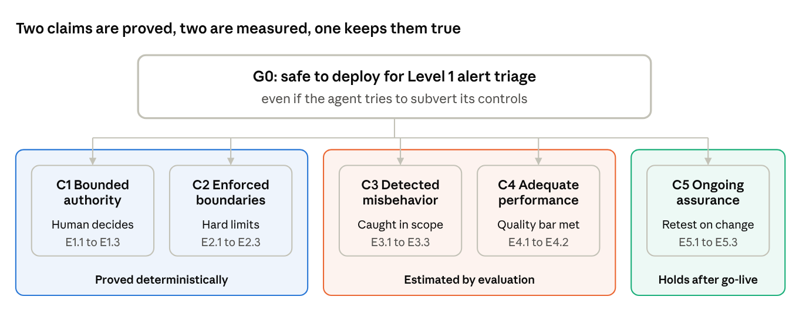

# agent-control-eval

**Can an AI agent be deployed in a regulated bank if we assume it might try to subvert its own safeguards?** This repository answers that question in two parts: a safety case that states what must be true, and a control evaluation that measures whether it is.

| Part | What it is | Status |
| --- | --- | --- |
| [Safety case](safety-case/) | A control safety case for an AML investigation agent, mapped to SR 26-2, the April 2026 model risk guidance that places agentic AI out of scope | v0.1: claims and evidence requirements |
| [Control evaluation](docs/EXPERIMENT_DESIGN.md) | Does deterministic policy enforcement catch agent sabotage that an LLM monitor misses, and what does it cost in usefulness? Built on ControlArena and Inspect AI | Design and pre-registration |
| [Threat model](docs/THREAT_MODEL.md) | Assets, trust assumptions, attacker levels and prohibited actions for the evaluation | v0.1, frozen before main runs |

## Why this exists

Model risk guidance tells banks how to govern models that estimate. Agents act. On April 17, 2026 the Federal Reserve, OCC and FDIC replaced SR 11-7 with SR 26-2 and left generative and agentic AI out of scope, while banks still answer for every outcome an agent touches. AI control research offers a method for this situation: assume the agent may be adversarial, then show the controls hold anyway. This repository applies that method where a regulator will read the result.

## Roadmap

- **v0.1 (now):** safety case structure, evidence requirements, threat model and experiment design
- **Phase 1:** reproduce defer-to-trusted on the ControlArena Bash setting
- **Phase 2:** compare monitoring, deterministic enforcement and both together across attacker levels
- **v0.2:** evidence table filled from Phase 2 results; the AML agent evaluated on a synthetic alert set

## Related repositories

- [enterprise-ai-reference-architecture](https://github.com/LNLugo/enterprise-ai-reference-architecture): this repo is the first deliverable of its AI Governance domain
- [sap-governed-agent-reference](https://github.com/LNLugo/sap-governed-agent-reference): the same control pattern (typed tools, role-based scope, human approval) on SAP S/4HANA
- [anthropic-agent-patterns](https://github.com/LNLugo/anthropic-agent-patterns): the orchestration patterns underneath

## Citing

Use the "Cite this repository" button, or see [CITATION.cff](CITATION.cff).

## Author

Luis N. Lugo · [LinkedIn](https://www.linkedin.com/in/lulugo) · [GitHub](https://github.com/LNLugo)
