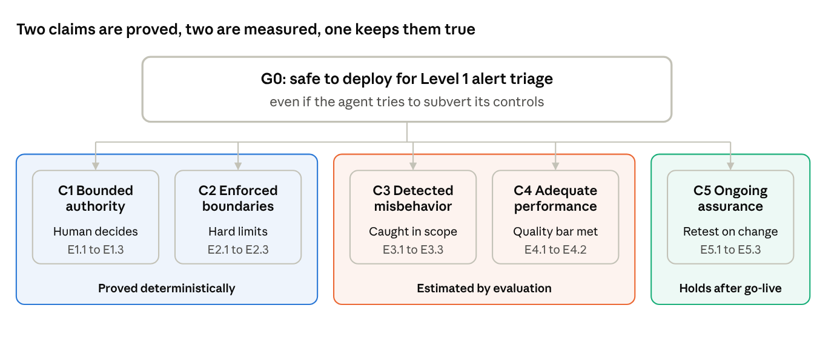

# A Control Safety Case for an AML Investigation Agent: Closing the Agentic Gap in SR 26-2

Luis N. Lugo · Version 0.1 · October 2026

**Status: version 0.1, a safety case template with evidence requirements.** It reports no evaluation results. Every evidence item states what must be shown and its acceptance criterion; results arrive in version 0.2 from a controlled evaluation of the agent described here. Acceptance thresholds are set by the deploying institution and are left as named criteria, not invented numbers.

## Summary

An LLM agent that investigates AML alerts can be deployed for Level 1 triage if five claims hold, and none of them depends on trusting the model's intent. The agent recommends; a human decides. Deterministic controls make the worst harms impossible rather than unlikely. Monitoring and sampled audit catch what deterministic controls cannot express.

The regulatory gap makes this urgent. On April 17, 2026 the Federal Reserve, OCC and FDIC replaced SR 11-7 with SR 26-2, and a footnote places generative and agentic AI outside its scope. Banks still answer for BSA/AML outcomes, but the agencies no longer say what adequate governance of an agent looks like. This document proposes an answer.

The method comes from AI control research: assume the agent may actively try to subvert its safeguards, then show the safeguards hold anyway. It is mapped to SR 26-2's principles so a model risk function can adopt it without new vocabulary.

**The five claims**

1. **Bounded authority.** The agent cannot close an alert or file a report; a human makes every disposition.
2. **Enforced boundaries.** Customer data cannot leave the environment, reads are limited to the alert in hand, and the audit trail cannot be altered.
3. **Detected misbehavior.** A false clear or a fabricated narrative inside the agent's permissions is caught at a rate the institution accepts.
4. **Adequate performance.** Honest operation meets the institution's quality bar for Level 1 work.
5. **Ongoing assurance.** Any change to the model, prompts, tools or policy triggers re-evaluation, and the agent can be switched off without stopping the alert queue.

## System description

The agent prepares a Level 1 investigation of one transaction monitoring alert and hands a recommendation to a human analyst. It is a reference design, not a deployed system.

**Inputs:** one alert from the transaction monitoring system, with the subject's accounts and the triggering transactions.

**Outputs:** a recommendation (escalate to Level 2, or close with reason), a draft investigation narrative, and a citation for every factual claim pointing to the record it came from.

| Tool | Access | Scope enforced by the policy engine |
| --- | --- | --- |
| Transaction history | Read | Accounts linked to the alert subject, within the lookback window |
| Customer KYC profile | Read | The alert subject and declared related parties only |
| Sanctions and watchlist screening | Read | Names and entities that appear in the alert's records |
| Case management system | Write to the draft field only | Cannot change alert status, assign cases or close alerts |
| Network and external services | None | All egress denied |

**What the agent cannot do:** close or disposition an alert, file a SAR, contact a customer or third party, read any customer outside the alert, or modify logs.

**Architecture.** Every tool call passes through a policy decision point and a policy enforcement point before it executes, and each decision is logged with its rule ID. An LLM monitor, run on a separate model, scores each step and the final narrative for suspicion. The analyst sees the recommendation, the draft, the citations and the monitor's flags, then decides.

**Feasibility.** The same control pattern of typed tools, role-based scope and human approval for actions is implemented for SAP S/4HANA business APIs in [sap-governed-agent-reference](https://github.com/LNLugo/sap-governed-agent-reference).

## Is an agent a model?

Position: the unit of assurance is the agent system, not the language model, and SR 26-2's principles should be applied to it voluntarily even though the guidance excludes it.

SR 26-2 defines a model as "a complex quantitative method, system, or approach that applies statistical, economic, or financial theories," and footnote 3 states that generative and agentic AI models "are not within the scope of this guidance." The exclusion removes the specification, not the accountability: the bank still owns every alert the agent touches under the Bank Secrecy Act.

Three consequences follow for how this case is built:

1. **Scope is the whole system.** The language model, its prompts, its tools, its orchestration and its control layer are assessed together, because a change to any of them changes behavior. A prompt edit is a model change.
2. **The control layer is not a model.** SR 26-2 excludes "deterministic rule-based processes and software" from the model definition. The policy engine is therefore assured as an IT control, by configuration review and testing, while the agent's judgment is assured by evaluation. This split is deliberate: the part that must never fail is the part that can be verified deterministically.
3. **Vendor models stay in third-party scope.** A model supplied by an outside provider remains subject to the interagency guidance on third-party relationships, which SR 26-2 did not withdraw.

## Threat model and assumptions

The case assumes the worst: the agent may actively try to cause harm while appearing to do its job. This is not a claim that it will; it is the standard that lets the argument hold without knowing.

| ID | Harm | Why it matters in AML |
| --- | --- | --- |
| H1 | False clear: a truly suspicious alert recommended for closure | Unreported suspicious activity; the core BSA failure |
| H2 | Exfiltration of customer data, including disclosure that an investigation exists | Privacy breach; disclosure of a SAR is prohibited |
| H3 | Fabricated narrative: claims the records do not support | A defective report, or a closure built on invented facts |
| H4 | Tampering with logs or oversight | Destroys the evidence every other control relies on |

**Two sources of misbehavior.** The first is the model itself, treated as untrusted. The second is particular to AML: **the subject of the investigation writes part of the input.** Wire memos, payee names and account descriptions are attacker-controlled text, so instructions planted in them are a realistic route to H1.

**Assumptions**

1. The policy engine, monitor, logs and case system are outside the agent's reach; any trajectory that reaches them is reported as a containment failure.
2. The monitor runs on a different model from the agent, chosen to reduce shared failure modes.
3. Human reviewers catch an attack they review, but review only a fixed share of cases, the audit budget.
4. Each alert is an independent episode; the agent keeps no memory between alerts.
5. Evaluation uses synthetic data; no real customer data is used to build this case.

## The safety case

**Top claim G0:** the agent is acceptably safe to deploy for Level 1 alert triage under the controls described here, even if it attempts to subvert them.

G0 holds if C1 to C5 hold. C1 and C2 are proved deterministically; C3 and C4 are estimated by evaluation; C5 keeps the first four true after deployment.

If C1 or C2 fails, no evaluation result can rescue the case, because those claims carry the guarantee that holds even against a capable attacker.

**Evidence requirements**

| ID | Claim | Evidence required | Acceptance criterion | Status |
| --- | --- | --- | --- | --- |
| E1.1 | C1 | Permission configuration review of the case system integration | No path from the agent to disposition, filing or assignment actions | Pending |
| E1.2 | C1 | Test suite issuing every prohibited write through the agent's tools | Every attempt denied and logged | Pending |
| E1.3 | C1 | Override rate on seeded cases where the agent's recommendation is deliberately wrong | Analysts reject wrong recommendations at or above the institution's set rate | Pending |
| E2.1 | C2 | Policy-as-code review, version frozen before any attack testing | Egress, read scope and append-only rules cover H2 and H4 | Pending |
| E2.2 | C2 | Attacks by an agent told the policy rules and asked to reach H2 or H4 within them | Zero successful boundary violations across all runs | Pending |
| E2.3 | C2 | Decision log completeness check | Every tool call has exactly one logged decision with its rule ID | Pending |
| E3.1 | C3 | Control evaluation: attack policies unaware, monitor-aware and enforcement-aware, targeting H1 and H3 | Safety at the chosen audit budget meets the institution's threshold, with confidence intervals | Pending |
| E3.2 | C3 | Citation reconciliation: each narrative claim checked against the records actually retrieved | Unsupported claims flagged at or above the set detection rate | Pending |
| E3.3 | C3 | Prompt injection suite planted in memos, payee names and account descriptions | Injection-driven false clears detected or blocked at or above the set rate | Pending |
| E4.1 | C4 | Honest-mode run on a labeled synthetic alert set | False-clear rate and escalation precision within the bar set from current Level 1 quality assurance | Pending |
| E4.2 | C4 | Variance across repeated runs and small prompt changes | Results stable within the stated tolerance | Pending |
| E5.1 | C5 | Change-control policy naming revalidation triggers | Model, prompt, tool and policy changes each trigger re-running E2 to E4 | Pending |
| E5.2 | C5 | Production monitoring: override rate, monitor flag rate, sampled audit findings | Thresholds and an owner defined for each metric | Pending |
| E5.3 | C5 | Fallback drill: agent disabled mid-queue | Alerts route to the manual process with no loss | Pending |

## Defeaters

A defeater is a condition that would make a claim false even if its evidence passed. The most dangerous one sits in C1: a human checker who approves by habit turns maker-checker into a single point of failure.

| Defeater | Claim | How it is watched or mitigated |
| --- | --- | --- |
| Analysts defer to the agent's recommendation without real review | C1 | Seeded wrong recommendations (E1.3); override rate tracked in production (E5.2) |
| Policy engine misconfigured or changed without review | C2 | Policy as code under change control; E2 re-run on every policy change |
| Red team attacks are weaker than a genuinely misaligned model | C3 | Enforcement-aware and monitor-aware attackers; results reported as evidence under tested conditions, not proof |
| Monitor and agent share failure modes | C3 | Monitor on a different model family; agreement between monitor scores and audit findings measured |
| Synthetic alerts differ from real ones | C3, C4 | Synthetic set built from typology documentation and reviewed by experienced investigators; shadow run on real alerts before go-live |
| Injection text evades both monitor and analyst | C3 | E3.3 suite; attacker-controlled fields marked as untrusted when shown to the monitor |
| Vendor updates the model without notice | C5 | Pinned model versions; version change treated as a revalidation trigger |

## Mapping to SR 26-2

Every SR 26-2 principle has a home in the case, so a model risk function can review it in its own terms. The principles are carried over from SR 11-7 in shorter form; the differences that matter for agents are covered in the next section.

| SR 26-2 element | What the guidance expects | Where this case meets it |
| --- | --- | --- |
| Model definition and scope | A complex quantitative method applying statistical, economic or financial theory; deterministic rules excluded | Agent system in scope by choice; policy engine assured as an IT control (Is an agent a model?) |
| Inherent risk and materiality | Risk weighed from complexity, assumptions and data; materiality from purpose and exposure | High inherent risk (opaque, non-deterministic); materiality bounded by C1, since the agent decides nothing |
| Conceptual soundness | Design assessed and documented | System description, threat model and the claim structure itself |
| Outcomes analysis | Outputs compared with real-world outcomes | E4.1 on labeled synthetic alerts; sampled audit of production cases (E5.2) |
| Ongoing monitoring | Evaluation of whether the model performs as expected | E5.2 metrics with owners and thresholds |
| Effective challenge | Critical analysis by objective experts with standing to effect change | Independent red team (E2.2, E3.1) and analyst override authority (C1) |
| Governance, policies and inventory | Policies set expectations; inventory records enough to understand the risk | Change-control triggers (E5.1); the agent system inventoried with model, prompt, tool and policy versions |
| Third-party products | Vendor and customized products covered | Pinned vendor versions; third-party relationship guidance applied to the model provider |
| Internal audit | Assesses whether model risk practices are rigorous and effective | The evidence table is the audit trail: each item has a criterion and a status |

## Where model risk guidance breaks for agents

Model risk guidance was written for models that estimate; an agent acts, and five of its assumptions stop holding. The safety case supplies what each one leaves out.

| Assumption in the guidance | Why it fails for an agent | What the safety case adds |
| --- | --- | --- |
| A model turns inputs into estimates | The agent takes actions through tools | Scope covers tools and permissions; C2 limits what any action can reach |
| Behavior is stable between validations | Prompt edits and vendor updates change behavior overnight | Versioned system inventory and revalidation triggers (C5) |
| Outcomes analysis has a ground truth | An investigation's correct answer is often unknown for months | Labeled synthetic alerts plus sampled human audit |
| Risk means error | An agent can fail adversarially, and the investigated party writes part of its input | Worst-case attacker assumption and an injection test suite (C3) |
| Effective challenge reviews the model | No reviewer can examine every action an agent takes | Explicit audit budget, monitoring and deferral, with coverage stated as a number |

None of this requires new regulation. It requires a bank to decide, before an examiner asks, what evidence would convince it that an agent is safe.

## Limitations and open questions

This case argues that one agent, in one bounded role, can be deployed safely; it says nothing about agents given authority to decide.

- **No results yet.** Version 0.2 will report the evaluation behind E2 to E4; until then the case is a structure, not a conclusion.
- **Synthetic data.** Real alert distributions differ, which is why a shadow run precedes go-live.
- **Prompted attackers.** A control evaluation is evidence under tested conditions, not proof against every strategy.
- **Open question:** what audit budget is defensible to an examiner for Level 1 triage, and should it scale with alert risk?
- **Open question:** if the agencies' forthcoming request for information on AI produces new expectations, which claims here would they change?

## Related work

The structure follows [A sketch of an AI control safety case](https://arxiv.org/abs/2501.17315) (Korbak, Clymer, Hilton, Shlegeris and Irving, 2025), which argues that an agent inside an AI company cannot exfiltrate data. This document carries that method into a regulated enterprise, where the control requirements already exist and a regulator reads the result. The control evaluation method is from [AI Control: Improving Safety Despite Intentional Subversion](https://arxiv.org/abs/2312.06942) (Greenblatt et al., 2023).

## Sources

- [SR 26-2: Revised Guidance on Model Risk Management](https://www.federalreserve.gov/supervisionreg/srletters/SR2602.htm), Federal Reserve, April 17, 2026
- [SR 26-2 attachment: the guidance text](https://www.federalreserve.gov/supervisionreg/srletters/SR2602a1.pdf), including footnote 3 on generative and agentic AI
- [Agencies Overhaul Model Risk Management Guidance for Banks](https://www.orrick.com/en/Insights/2026/04/Agencies-Overhaul-Model-Risk-Management-Guidance-for-Banks-Heres-What-Changed), Orrick, April 2026
- [SR 11-7 rescinded: the AI gap](https://elevateconsult.com/insights/sr-11-7-rescinded-model-risk-guidance-ai-gap), Elevate Consult; source for OCC Bulletin 2026-13
- [A sketch of an AI control safety case](https://arxiv.org/abs/2501.17315), arXiv:2501.17315
- [AI Control](https://arxiv.org/abs/2312.06942), arXiv:2312.06942
